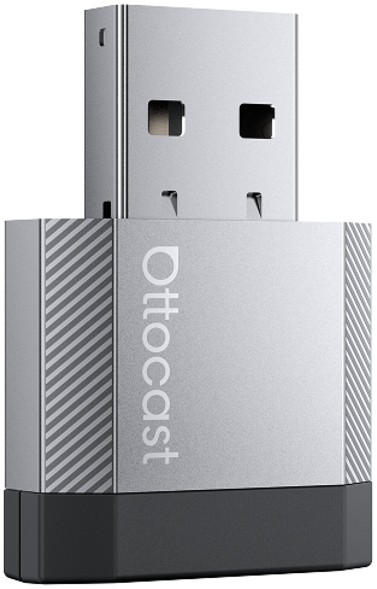
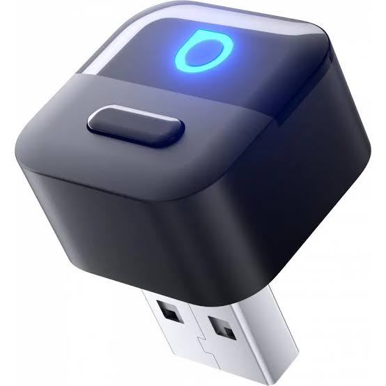
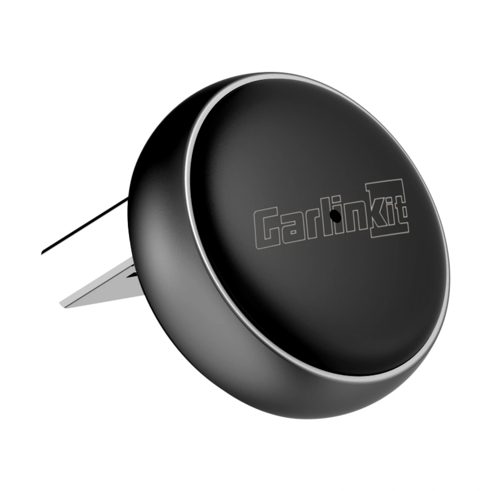
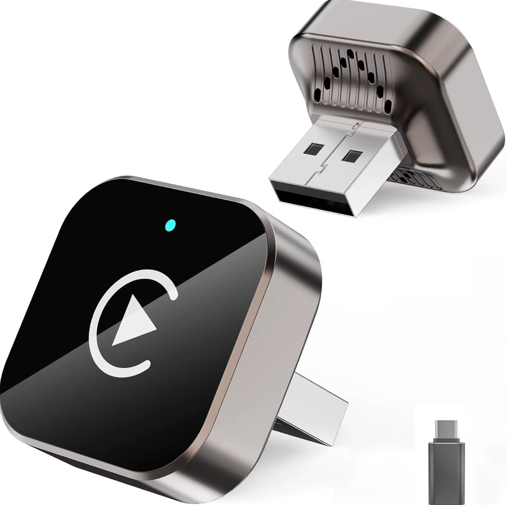
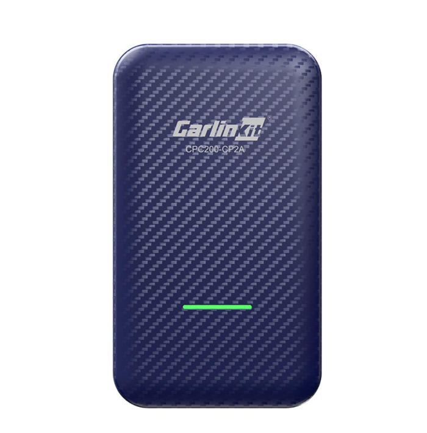
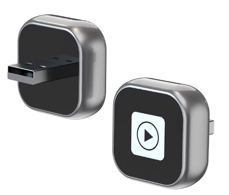

# Wireless CarPlay AltScreen Dongles

Modified firmware for wireless CarPlay adapters that carries the **Apple Maps cluster view (altScreen)** to the Virtual Cockpit. With it you get the map, zoom, view switching and turn-by-turn on the instrument cluster without a cable.

> [!CAUTION]
> **Use at your own risk.** This is unofficial, modified firmware. It is provided free of charge, **as is, with no warranty of any kind**.
>
> - Flashing can **brick your adapter**. Recovery may require opening the case and an SPI flash programmer. During development one adapter was bricked and had to be recovered that way.
> - Flashing voids the adapter's warranty and may break features that work today.
> - Each image is built for **one exact adapter model and stock firmware version**. Do not flash it on anything else, even if the adapter looks the same.
> - You are responsible for anything that happens to your adapter, your phone, your car or yourself. **Do not install or test while driving.**
>
> If you cannot accept the risk of losing the adapter, do not use these images.

## Supported adapters

Adapters are grouped by the software platform inside them, not by brand: the same brand can use different platforms, and different brands can share one.

| | Adapter | Based on | Cluster map | Zoom / View | Turn-by-turn | USB | HTTP | Flash |
|---|---|---|:-:|:-:|:-:|:-:|:-:|:-:|
| | **[Liaoyuan (LY) platform](firmware/liaoyuan/)** | | | | | | | |
|  | [**Ottocast** CA530 (ly5140)](firmware/liaoyuan/ly5140-ottocast-ca530/) | `26101218.5140.2` | ✅ stock | ✅ | ✅ | — | ✅ | — |
|  | [**Ottocast** CA525-T2 (ly6071)](firmware/liaoyuan/ly6071-ottocast-ca525-t2/) | `26101215.6071.2` | ⚠️ stock ⁵ | ⚠️ ⁵ | ⚠️ ⁵ | — | ⚠️ ⁵ | — |
|  | [**Carlinkit Mini Ultra 3** (ly6238)](firmware/liaoyuan/ly6238-carlinkit-mini-ultra3/) | `26011618.6238.2` | ✅ stock | ⚠️ ⁴ | ✅ | — | ✅ | — |
|  | [**No-name "smartBox"** (ly7101)](firmware/liaoyuan/ly7101-smartbox/) | `26102410.7101.2` | ✅ stock | ✅ | ✅ | — | ✅ | — |
| | **Carlinkit Autokit platform** | | | | | | | |
|  | [**Carlinkit 4.0** (U2AW)](firmware/carlinkit-autokit/u2aw/) | `2023.10.16.0952` | ✅ | ✅ | ✅ | ⚠️ ¹ | — ² | ✅ ³ |
| | **YouCast platform** | | | | | | | |
|  | [**YouCast** YCA01 (C12P)](firmware/youcast/c12p/) | `25102301.C12P` | ✅ | ✅ | ✅ | — | ✅ | ✅ ³ |

✅ works and was tested · ⚠️ built or seen working, not fully confirmed · ❌ not done yet · — not available

- **USB**: install from a USB stick plugged into the adapter.
- **HTTP**: upload the image to the adapter's web interface over its Wi-Fi.
- **Flash**: write the SPI flash chip directly with a programmer and a SOIC-8 clip. This is the recovery path when nothing else boots.

¹ The USB image is built and checked offline but has not been flashed to a real adapter yet.
² Carlinkit 4.0 has no HTTP upload here. The tested install is over SSH, see [its page](firmware/carlinkit-autokit/u2aw/).
³ Recovery only: write back a full dump of **your own** chip, taken before you change anything.
⁴ **View** works; zoom is not confirmed in the car yet.
⁵ Same changes as the CA530, ported to this firmware. Built and checked offline only, not installed on a real adapter yet.

## What the firmware adds

The head unit offers CarPlay a second display, the instrument cluster. Stock adapters lose part of that on the way between the car and the iPhone. Depending on the adapter, the modified firmware:

- passes the cluster display (type 111) to the iPhone and the second video stream back to the car;
- forwards zoom (`changeMapZoomLevel`) from the steering wheel and the **View** button (`showUI`, `updateViewArea`) to the iPhone;
- passes the cluster's safe areas to the iPhone, so the map layout matches the cable connection;
- relays route guidance (iAP2 `0x52xx`): arrows, lanes, street name.

Details for each adapter are on its page; for an LY adapter start with [how to find your adapter](firmware/liaoyuan/).

## Requirements

The adapter firmware alone does not put anything on the cluster. The head unit must have the CarPlay cluster map patch installed:
**[MHI2-Carplay-Maps](https://github.com/zakklmv/MHI2-Carplay-Maps)**. Turn-by-turn through an adapter needs native guidance from the same project.

Tested only on **MHI2 MU1440 + 790 Active Info Display (AID 10.5)**, Škoda, with an iPhone and Apple Maps. Other cars, head units and navigation apps were not tested.

## Before you flash

1. Check the exact model and the stock firmware version in the adapter's web interface or app. They must match the table.
2. Read the page of your adapter to the end, including **Rollback** and **Known issues**.
3. Keep the stock firmware for your adapter. If you have a programmer, make a full dump of the flash chip first.
4. Do the install on the bench, with the adapter on a stable power supply. Do not unplug it while it updates.

## Repository layout

```
firmware/
  liaoyuan/                        Liaoyuan (LY) platform: README tells which folder fits
    ly5140-ottocast-ca530/         ottocast_lyh.img          HTTP image
    ly6071-ottocast-ca525-t2/      ly6071_lyh.img            HTTP image
    ly6238-carlinkit-mini-ultra3/  mini-ultra3_lyh.img       HTTP image
    ly7101-smartbox/               ly7101_lyh.img            HTTP image
  carlinkit-autokit/
    u2aw/                          U2AW_AUTOKIT_Update.img   USB image
                                   ssh/                      libcl.so + install / uninstall scripts
  youcast/
    c12p/                          c12p_050-4-32bc9459-rel.img  HTTP image
docs/images/                       adapter photos
SHA256SUMS.txt                     checksums of everything in firmware/
```

Check the download before flashing:

```sh
sha256sum -c SHA256SUMS.txt
```

## License and trademarks

The code written for this project (hook libraries and scripts) is licensed under the [GNU GPL v3](LICENSE). See sections 15 and 16 of the license: **no warranty, no liability**.

The images also contain the adapters' original firmware. That part belongs to its manufacturers and is not covered by the GPL.

This project is not affiliated with, endorsed or supported by Apple, Volkswagen Group, Škoda, Ottocast, Carlinkit, YouCast or any other manufacturer. CarPlay is a trademark of Apple Inc. Brand names are used only to say which hardware the files are for.

## Credits

- [ludwig-v](https://github.com/ludwig-v/wireless-carplay-dongle-reverse-engineering) for the Carlinkit firmware research, tools and custom firmware.
- omonob (QCDWJ) for the original open-source CarPlay cluster map project for MHI2.
