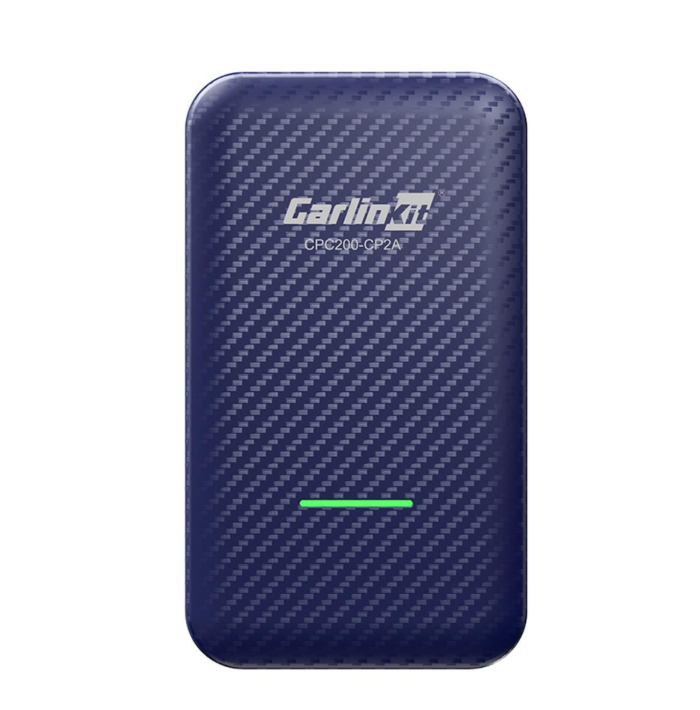

# Carlinkit 4.0 (U2AW)



> [!CAUTION]
> Use at your own risk, no warranty. Read the [main page](../../README.md) first.
> This adapter was bricked once during development and was recovered only with an SPI programmer.

## Hardware

| | |
|---|---|
| Model | Carlinkit CarPlay 4.0, product **U2AW** (`_AUTOKIT`) |
| Platform | ARM Linux, glibc 2.20 |
| Flash | MX25L12835F, 16 MB SPI NOR |
| Firmware | [ludwig-v custom firmware](https://github.com/ludwig-v/wireless-carplay-dongle-reverse-engineering) based on `2023.10.16.0952` |
| Adapter address | Wi-Fi of the adapter, `192.168.50.2` (SSH) |

The stock firmware does not show the map on the cluster at all. The head unit offers both displays and the iPhone supports `altScreen`, but the adapter does not pass the second display between them.

## What is changed

A library `libcl.so` is loaded into `AppleCarPlay`, `fakeiOSDevice` and `ARMiPhoneIAP2`:

- the cluster display (type 111) is offered to the iPhone;
- the second video stream from the iPhone is received, decrypted (ChaCha20-Poly1305), re-encrypted (AES-CTR) and sent to the head unit;
- zoom, **View** (`showUI`, `updateViewArea`) and the other cluster commands from the car are forwarded to the iPhone; stock firmware answered "success" and dropped them;
- the cluster's key frame requests no longer reset the main screen video, which made the head unit menu flip on its own;
- route guidance (iAP2 `0x52xx`) is added to the identification and relayed in both directions.

### Safety: boot counter

The library is copied to `/tmp` at every boot; `/etc/ld.so.preload` is never pointed at flash. A counter in `/etc/cl/arm` starts at 8 and goes down at every boot. After 60 seconds of a healthy boot it is set back to 8. If the library breaks the system, the hook switches itself off after 8 boots and the adapter boots stock.

The counter does **not** help if programs keep running but CarPlay fails, for example when the iPhone rejects the identification. Then remove the hook over SSH (see Rollback).

## Files

| File | SHA-256 |
|---|---|
| `U2AW_AUTOKIT_Update.img` | `c44c6cdcaa2c5d13fb4a142fe4ce08f7f260183b9566d757cd80da85012f72d8` |
| `ssh/libcl.so` | `bd92d467ee97416706fd3479e7744a16484f4137a71fa7160449111fcc27ad15` |
| `ssh/install.sh` | `b547708b1314c12600bb382c44b818f6cf36305b8d9bb4f115bd19cf760f8471` |
| `ssh/uninstall.sh` | `97051aa8458b274d473164bcee034084230a97f2aaa55230bc6654912718a4a3` |

The USB image is the [ludwig-v custom firmware](https://github.com/ludwig-v/wireless-carplay-dongle-reverse-engineering) `U2AW/_AUTOKIT/2023.10.16.0952` with `libcl.so` and the boot counter added. Nothing else is changed.

## Install over SSH (tested)

Requires the adapter to already run the [ludwig-v custom firmware](https://github.com/ludwig-v/wireless-carplay-dongle-reverse-engineering) `2023.10.16.0952`.

Run from **Git Bash** in this folder. Do not use a PowerShell pipe (`cat file | ssh`): it adds CRLF and breaks the files.

```sh
ssh root@192.168.50.2 'cat > /tmp/libcl.so' < ssh/libcl.so
ssh root@192.168.50.2 'cat > /tmp/install.sh' < ssh/install.sh
ssh root@192.168.50.2 'sh /tmp/install.sh && /sbin/reboot'
```

`install.sh` prints `armed for the next 8 boots` and the patched boot block.

## Install from USB (not tested)

> [!WARNING]
> This image was built and checked offline only. It has not been installed on a real adapter yet.

1. Copy `U2AW_AUTOKIT_Update.img` to the root of a FAT32 USB stick. The file name must stay exactly the same.
2. Power the adapter on the bench (not in the car) and plug the stick into its USB port.
3. Wait until the update finishes and the adapter reboots, then remove the stick.

## Check

After the first boot in the car, over SSH:

```sh
cat /tmp/cl.log
```

Expected lines: `fakeiOSDevice: features=1 commands=1`, `head unit SETUP 111 status=200`, commands with `rc=0`. For guidance: `iPhone accepted the identification`, `rg to iPhone id=5200`, `rg from iPhone id=5201`.

The log lives in `/tmp` and is lost when the adapter loses power. Save it before turning the ignition off.

## Rollback

```sh
ssh root@192.168.50.2 'cat > /tmp/uninstall.sh' < ssh/uninstall.sh
ssh root@192.168.50.2 'sh /tmp/uninstall.sh && /sbin/reboot'
```

If the adapter no longer boots: write back your own flash dump with a programmer.

## Known issues

- Works only with `2023.10.16.0952`. Code addresses do not fit other versions.
- Turn-by-turn looked fine in the car, but no car log has confirmed it yet.
- The [ludwig-v custom firmware](https://github.com/ludwig-v/wireless-carplay-dongle-reverse-engineering) has **SSH as root with an empty password**. Change the adapter's Wi-Fi password.
- Do not leave a USB stick in the adapter while driving: it can drop CarPlay after a few seconds.
- Build the library with GCC only. A build with zig crashed every new process on this adapter's libc and bricked it.
