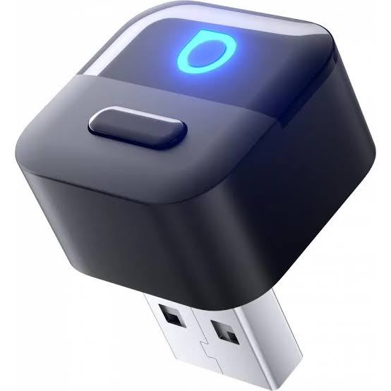

# Ottocast CA525-T2 (ly6071)



> [!CAUTION]
> Use at your own risk, no warranty. Read the [main page](../../../README.md) first.
> **This image has not been installed on a real adapter yet.** It was built and checked offline only.

## Hardware

| | |
|---|---|
| Model | Ottocast CA525-T2, project **ly6071** |
| Platform | Liaoyuan (LY) OEM, RISC-V, Linux, musl |
| Stock firmware | `26101215.6071.2` |
| Adapter address | Wi-Fi of the adapter, `http://192.168.1.101` |

Same Liaoyuan platform as the [Ottocast CA530](../ly5140-ottocast-ca530/). The iPhone side of the CarPlay code (`lylinkapp`, `libwcarplay_new.so`, `libiap_new.so`) is byte for byte the same as on the CA530 `26101218.5140.2`; the car side (`rcpservice`, `librcarplay.so`) is a different build.

As on the CA530, the stock firmware sends the cluster map to the car but drops what the car sends back: zoom does nothing, **View** always opens the same screen, and the map layout differs from the cable connection.

## What is changed

The same library as for the CA530, `libLyH.so`, is loaded into the adapter's CarPlay services (`LD_PRELOAD` in `lyLink.sh`). The car-side addresses were found again for this firmware; the iPhone-side ones are the CA530 ones. At start the library checks the code bytes in memory and patches only when they match `26101215.6071.2`. If they do not match, that patch is skipped and the stock behaviour stays.

- `changeMapZoomLevel` from the car is forwarded to the iPhone (stock firmware threw it away).
- The `showUI` URL from the car is passed through instead of a hardcoded one, so **View** switches between map views; `updateViewArea` is passed on as in stock and logged.
- The iPhone is told that the cluster has `viewAreas`, so the safe area and layout match the cable. `adjacentViewAreas` is left as in stock, the same state that works on the CA530.
- Turn-by-turn (iAP2 `0x52xx`) passes through the stock adapter code. The head unit side needs native guidance bridge **0.6.4 or newer** from [MHI2-Carplay-Maps](https://github.com/zakklmv/MHI2-Carplay-Maps).

### Safety

- **The library runs from a copy in `/tmp`**, so the app partition is not kept busy and the next web update can unmount it, as with the stock firmware.
- **Boot counter.** A counter on the settings partition (`/mnt/UDISK/lyh_arm`) gives the library 5 starts. When both CarPlay programs have run together for 10 seconds, it goes back to 5. If the library ever breaks the start-up, it switches itself off after 5 boots and the adapter runs stock. Only a different build arms it again.
- The library is loaded only into `rcpservice` and `lylinkapp`. The web interface and the updater never load it.
- The app partition grows by exactly one 4 KB block over stock (3,715,072 → 3,719,168 bytes); the build refuses anything bigger. The partition size on this adapter is not known yet.

## File

| File | SHA-256 |
|---|---|
| `ly6071_lyh.img` | `0759f2b3f83fa32a369870a7ace0b2cfeba82cc2bc1012c185313ed46b07637b` |

The image is the stock `26101215.6071.2` package plus the library and its start block. Only `app/libLyH.so` and `app/lyLink.sh` differ; the kernel and `sw-description` are byte for byte stock. Installing it also updates the adapter to `26101215.6071.2`.

Stock package: SHA-256 `02d082a3463604af51f055049cb95a2f8baba13b105e80c758c6893d6c18c220` (6,676,525 bytes).

## Install (HTTP, not tested)

The adapter can be powered from any USB charger; the car is not needed.

1. Connect the computer to the adapter's Wi-Fi and open `http://192.168.1.101` to check that the version contains `.6071.`.
2. In this folder run:
   ```powershell
   curl.exe -F "file=@ly6071_lyh.img" "http://192.168.1.101/cgi-bin/index.cgi?id=upload"
   ```
3. Wait for the reboot. **It can take up to 8 minutes. Do not unplug the adapter.**

## Check

Open `http://192.168.1.101/lyh.txt`. It should contain:

```
lyh boot: ver=a7d54757 arm=5 preload=/tmp/libLyH.so
rcpservice: showUI-len=1 zoom=1
lylinkapp: viewAreas=1 adjacent=-1
lylinkapp: url=1 zoom=1
```

and no `bytes differ` lines (`adjacent=-1` means that patch is off on purpose). `preload=none` means the boot counter has switched the library off and the adapter runs stock. Then connect CarPlay through the adapter and start a route in Apple Maps. The cluster should show the map, the maneuver arrow and lanes; zoom on the steering wheel and the **View** button should work. Each **View** press adds an `app: UpdateViewArea ... status=0` line.

## Logs

While the adapter is on, connect to its Wi-Fi and save:

- `http://192.168.1.101/lyh.txt`: library log
- `http://192.168.1.101/lyh-cp.txt`: display info sent to the iPhone
- `http://192.168.1.101/cgi-bin/index.cgi?id=logcat`: stock log

The logs are kept in RAM only (up to 64 KB and 256 KB) and are lost on reboot. **`lyh.txt` contains street names from your route**, and anyone on the adapter's Wi-Fi can read it.

## Rollback

Upload the stock `update.img` for this adapter with the same `curl.exe` command. This works as long as the adapter's web page opens. Rollback was not tested on this adapter.

## Known issues

- Not installed on a real adapter yet. Please report the `lyh.txt` lines after the first boot.
- Works only with `26101215.6071.2`. A newer firmware needs a new build; with other code the patches are skipped.
- **Do not flash the CA530 (ly5140), Mini Ultra 3 (ly6238) or ly7101 images on this box**, and do not flash this image on them. They decrypt the same way, but the code addresses are different.
- Many very short power-ons in a row (under ~15 s each) also use up the boot counter and switch the library off. Upload a new build to arm it again.
- USB update and flash recovery were not tried on this adapter.
