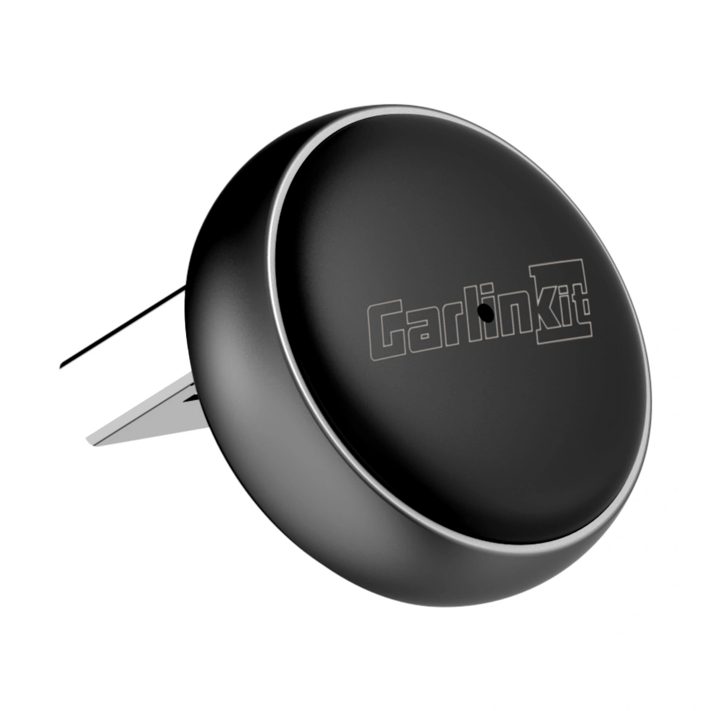

# Carlinkit Mini Ultra 3 (ly6238)



> [!CAUTION]
> Use at your own risk, no warranty. Read the [main page](../../../README.md) first.
> Tested in the car: cluster map, **View**, turn-by-turn and layout work. **Zoom from the steering wheel is not confirmed yet.**

## Hardware

| | |
|---|---|
| Model | Carlinkit Mini Ultra 3, project **ly6238** |
| Platform | Liaoyuan (LY) OEM, Allwinner V821, RISC-V (Andes), Linux, musl |
| Stock firmware | `26011618.6238.2` |
| Adapter address | Wi-Fi of the adapter, `http://192.168.50.100` |

The box is sold as Carlinkit and its web page talks to Carlinkit servers, but inside it is not the Carlinkit platform of the [Carlinkit 4.0](../../carlinkit-autokit/u2aw/). It is the same Liaoyuan platform as the [Ottocast CA530](../ly5140-ottocast-ca530/): same image encryption, same programs, a slightly older build of the same CarPlay code.

The stock code is the same as Ottocast's, so the adapter should behave the same way. It sends the cluster map to the car, but it drops what the car sends back: zoom does nothing, **View** always opens the same screen, and the map layout differs from the cable connection.

## What is changed

The same library as for Ottocast, `libLyH.so`, is loaded into the adapter's CarPlay services (`LD_PRELOAD` in `lyLink.sh`). Every code address was found again for this firmware. At start the library checks the code bytes in memory and patches only when they match `26011618.6238.2`. If they do not match, that patch is skipped and the stock behaviour stays.

- `changeMapZoomLevel` from the car is forwarded to the iPhone (stock firmware threw it away).
- The `showUI` URL from the car is passed through instead of a hardcoded one, so **View** switches between map views.
- The iPhone is told about the cluster's `viewAreas` and `adjacentViewAreas`, so the safe area and layout match the cable.
- Turn-by-turn (iAP2 `0x52xx`) passes through the stock adapter code as on Ottocast. The head unit side needs native guidance bridge **0.6.4 or newer** from [MHI2-Carplay-Maps](https://github.com/zakklmv/MHI2-Carplay-Maps).

### Safety

- **The library runs from a copy in `/tmp`.** Before an update the adapter stops its programs and unmounts the app partition. `rcpservice` is not stopped, so a library loaded from the app partition could keep it busy and hang the next web update, as happened on YouCast. With the copy in `/tmp` the partition is free, just as with the stock firmware.
- **Boot counter.** A counter on the adapter's settings partition (`/mnt/UDISK/lyh_arm`) gives the library 5 starts. Every boot uses one. When both CarPlay programs have run together for 10 seconds, the counter goes back to 5. If the library ever breaks the start-up, it switches itself off after 5 boots and the adapter runs stock. Only a different build arms it again; uploading the same image does not.
- The library is loaded only into `rcpservice` and `lylinkapp`. The web interface and the updater never load it, so a fault breaks CarPlay but not the web upload.
- The app partition grows by exactly one 4 KB block over stock (3,035,136 → 3,039,232 bytes); the build refuses anything bigger. On a stock `26011618.6238.2` adapter the partition is 3,801,088 bytes (`customer` 0xB00000–0xEA0000 in the boot log), so about 744 KB is left free.

## File

| File | SHA-256 |
|---|---|
| `mini-ultra3_lyh.img` | `186440019ed0adb73adc47e5bc9deb319fe3933ae397dfd28df636491a562a89` |

The image is the stock `26011618.6238.2` package plus the library and its start block. Only `app/libLyH.so` and `app/lyLink.sh` differ; the kernel and `sw-description` are byte for byte stock. Installing it also updates the adapter to `26011618.6238.2`.

Stock package: `https://cpbox-abroad.oss-us-west-1.aliyuncs.com/6238/update.img` (MD5 `eb1caf3f657e62d552db62bcb81e3551`).

## Install (HTTP)

The adapter can be powered from any USB charger; the car is not needed.

1. Connect the computer to the adapter's Wi-Fi.
2. In this folder run:
   ```powershell
   curl.exe -F "file=@mini-ultra3_lyh.img" "http://192.168.50.100/cgi-bin/index.cgi?id=upload"
   ```
   This is the same request the adapter's own web page sends for an online update (`multipart/form-data`, field `file`). The answer is `{"code": 0, "msg": "upload successful"}`.
3. Wait for the reboot. **The adapter's web page allows up to 8 minutes for it. Do not unplug the adapter.**

## Check

Open `http://192.168.50.100/lyh.txt`. It should contain:

```
lyh boot: ver=2f04d213 arm=5 preload=/tmp/libLyH.so
rcpservice: showUI-len=1 zoom=1
lylinkapp: viewAreas=1 adjacent=1
lylinkapp: url=1 zoom=1
```

and no `bytes differ` lines. `preload=none` means the boot counter has switched the library off (or the settings partition was not available), and the adapter runs stock. Then connect CarPlay through the adapter and start a route in Apple Maps. The cluster should show the map, the maneuver arrow and lanes, and the guidance line at the bottom of the map should be fully visible. Try zoom on the steering wheel and the **View** button.

## Logs

While the adapter is on, connect to its Wi-Fi and save:

- `http://192.168.50.100/lyh.txt`: library log
- `http://192.168.50.100/lyh-cp.txt`: display info sent to the iPhone
- `http://192.168.50.100/cgi-bin/index.cgi?id=logcat`: stock log

The logs are kept in RAM only (up to 64 KB and 256 KB) and are lost on reboot. **`lyh.txt` contains street names from your route**, and anyone on the adapter's Wi-Fi can read it.

## Rollback

Upload the stock `update.img` (link above) with the same `curl.exe` command. This works as long as the adapter's web page opens. Rollback was not tested on this adapter.

## Known issues

- Zoom was not confirmed in the car yet. If it does nothing, please send `lyh.txt` (lines `rcp: changeMapZoomLevel` and `app: zoom`).
- Many very short power-ons in a row (under ~15 s each, before CarPlay is up) also use up the boot counter and switch the library off. Upload a new build to arm it again.
- Works only with `26011618.6238.2`. A newer firmware needs a new build; with other code the patches are skipped.
- **Do not flash this image on an Ottocast ly5140 or an LY5101 box**, and do not flash the Ottocast image on this one. They decrypt the same way, but the code addresses are different.
- **Do not flash this image on an ly7101 box** (`26102410.7101.x`). It is an ARM adapter, this image is RISC-V; use [its own image](../ly7101-smartbox/).
- USB update and flash recovery were not tried on this adapter.
