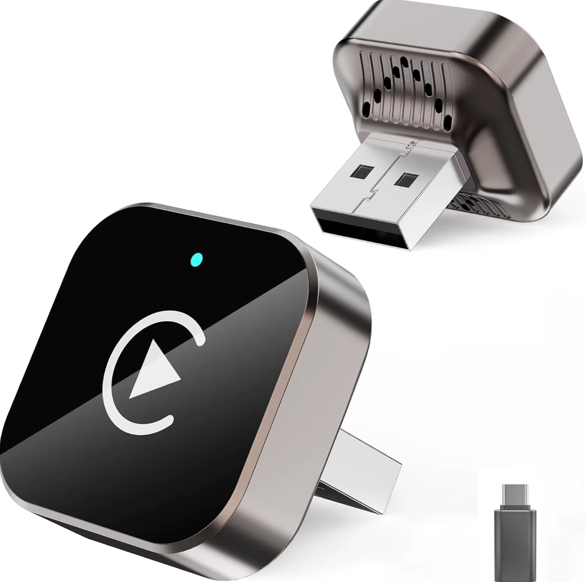

# No-name ly7101 ("smartBox")



> [!CAUTION]
> Use at your own risk, no warranty. Read the [main page](../../../README.md) first.

## Hardware

| | |
|---|---|
| Model | Unbranded square adapter, project **ly7101**; Wi-Fi name `smartBox-XXXX` |
| Platform | Liaoyuan (LY) OEM, AXERA AX520, **ARMv7**, Linux 4.9, uClibc |
| Stock firmware | `26102410.7101.2` (the image also installs it over older `7101` builds) |
| Adapter address | Wi-Fi of the adapter, `http://192.168.1.101` |

It is sold under different names, so check the firmware, not the case: the web page shows a version ending in **`.7101.x`**. Inside it is the same Liaoyuan software as the [Ottocast CA530](../ly5140-ottocast-ca530/) and the [Carlinkit Mini Ultra 3](../ly6238-carlinkit-mini-ultra3/), but on an ARM chip instead of RISC-V. Their images do not work on this box, and this image does not work on them.

As on Ottocast, the stock firmware sends the cluster map to the car but drops what the car sends back: zoom does nothing, **View** always opens the same screen, and the map layout differs from the cable connection.

## What is changed

The same library as for Ottocast, `libLyH.so`, built for ARM, is loaded into the adapter's CarPlay services (`LD_PRELOAD` in `lyLink.sh`). Every code address was found again for this firmware. At start the library checks the code bytes in memory and patches only when they match `26102410.7101.2`. If they do not match, that patch is skipped and the stock behaviour stays.

- `changeMapZoomLevel` from the car is forwarded to the iPhone (stock firmware threw it away).
- The `showUI` URL from the car is passed through instead of a hardcoded one, so **View** switches between map views; `updateViewArea` is passed on as in stock and logged.
- The iPhone is told that the cluster has `viewAreas`, so the safe area and layout match the cable. `adjacentViewAreas` is left as in stock, the same state that works on Ottocast.
- Turn-by-turn (iAP2 `0x52xx`) passes through the stock adapter code. The head unit side needs native guidance bridge **0.6.4 or newer** from [MHI2-Carplay-Maps](https://github.com/zakklmv/MHI2-Carplay-Maps).

### Safety

- **The library runs from a copy in `/tmp`**, so the app partition is not kept busy and the next web update can unmount it, as with the stock firmware.
- **Boot counter.** A counter on the settings partition (`/mnt/UDISK/lyh_arm`) gives the library 5 starts. When both CarPlay programs have run together for 10 seconds, it goes back to 5. If the library ever breaks the start-up, it switches itself off after 5 boots and the adapter runs stock. Only a different build arms it again.
- The library is loaded only into `rcpservice` and `lylinkapp`. The web interface and the updater never load it.
- The app partition image is 3,002,368 bytes, smaller than stock (3,047,424) because it is recompressed; the partition on the adapter is 4,456,448 bytes.

## File

| File | SHA-256 |
|---|---|
| `ly7101_lyh.img` | `b4eb9c9ca4dbea42dcaefc2696d45586c071c2b1665b47d6e708f7d6075e5b11` |

The image is the stock `26102410.7101.2` package plus the library and its start block. Only `app/libLyH.so` and `app/lyLink.sh` differ; the kernel and `sw-description` are byte for byte stock.

Stock package: `https://cpbox-abroad.oss-us-west-1.aliyuncs.com/7101/update.img` (5,676,077 bytes, SHA-256 `0c0fb217429f8c824fc9c55629d69488242720b96f75686f57fa6bc96803e4f1`).

## Install (HTTP)

The adapter can be powered from any USB charger; the car is not needed.

1. Connect the computer to the adapter's Wi-Fi and open `http://192.168.1.101` to check that the version contains `.7101.`.
2. In this folder run:
   ```powershell
   curl.exe -F "file=@ly7101_lyh.img" "http://192.168.1.101/cgi-bin/index.cgi?id=upload"
   ```
3. Wait for the reboot. **It can take up to 8 minutes. Do not unplug the adapter.**

## Check

Open `http://192.168.1.101/lyh.txt`. It should contain:

```
lyh boot: ver=5a823b22 arm=5 preload=/tmp/libLyH.so
rcpservice: showUI-len=1 zoom=1
lylinkapp: viewAreas=1 adjacent=-1
lylinkapp: url=1 zoom=1
```

and no `bytes differ` lines (`adjacent=-1` means that patch is off on purpose). `preload=none` means the boot counter has switched the library off and the adapter runs stock. Then connect CarPlay through the adapter and start a route in Apple Maps. The cluster should show the map, the maneuver arrow and lanes; zoom on the steering wheel and the **View** button should work. Each **View** press adds an `app: UpdateViewArea ... status=0` line.

## Logs

While the adapter is on, connect to its Wi-Fi and save:

- `http://192.168.1.101/lyh.txt`: library log
- `http://192.168.1.101/cgi-bin/index.cgi?id=logcat`: stock log

The logs are kept in RAM only (up to 64 KB) and are lost on reboot. Anyone on the adapter's Wi-Fi can read them; the stock log contains the adapter's serial number and MAC addresses.

## Rollback

Upload the stock `update.img` (link above) with the same `curl.exe` command. This works as long as the adapter's web page opens. Rollback was not tested on this adapter.

## Known issues

- Works only with `26102410.7101.2`. A newer firmware needs a new build; with other code the patches are skipped.
- **Do not flash Ottocast (CA530, CA525-T2), Mini Ultra 3 or other LY images on this box**, and do not flash this image on them. An `ly5101` image uploaded to this box was not installed and the box stayed on stock, but do not count on that; a RISC-V library from those images (ly5101, ly5140, ly6071, ly6238) cannot load here.
- Many very short power-ons in a row (under ~15 s each) also use up the boot counter and switch the library off. Upload a new build to arm it again.
- USB update and flash recovery were not tried on this adapter.
