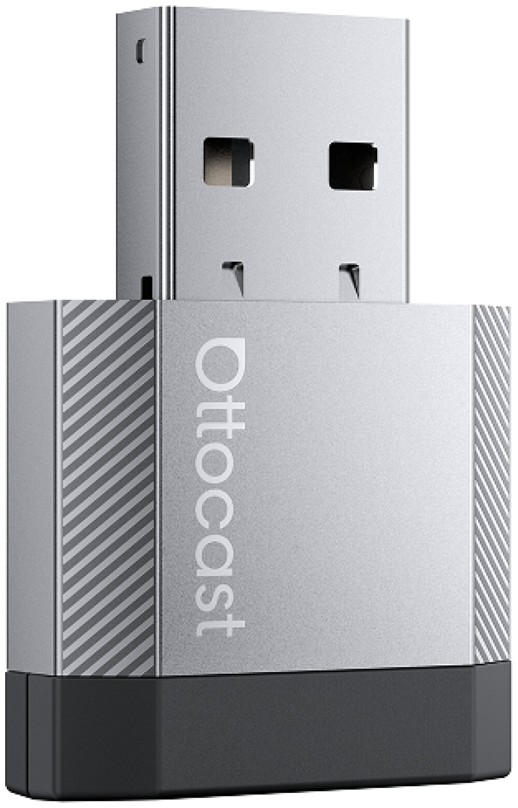

# Ottocast CA530 (ly5140)



> [!CAUTION]
> Use at your own risk, no warranty. Read the [main page](../../README.md) first.

## Hardware

| | |
|---|---|
| Model | Ottocast CA530 (T3 / Mini / Nova family), project **ly5140** |
| Platform | Liaoyuan (LY) OEM, RISC-V (Andes), Linux, musl |
| Stock firmware | `26101218.5140.2` |
| Adapter address | Wi-Fi of the adapter, `http://192.168.1.101` |

The stock firmware already sends the cluster map to the car, but it drops everything the car sends back: zoom does nothing, **View** always opens the same screen, and the map layout differs from the cable connection.

## What is changed

A small library `libLyH.so` is loaded into the adapter's CarPlay services (`LD_PRELOAD` in `lyLink.sh`). At start it checks the code bytes in memory and patches only when they match the expected firmware. If they do not match, the patch is skipped.

- `changeMapZoomLevel` from the car is forwarded to the iPhone (stock firmware threw it away).
- The `showUI` URL from the car is passed through instead of a hardcoded one, so **View** switches between map views.
- The iPhone is told about the cluster's `viewAreas` and `adjacentViewAreas`, so the safe area and layout match the cable.
- Turn-by-turn (iAP2 `0x52xx`) already passes through the adapter. The head unit side needs native guidance bridge **0.6.4 or newer** from [MHI2-Carplay-Maps](https://github.com/zakklmv/MHI2-Carplay-Maps), which handles the short guidance reply Ottocast sends.

## File

| File | SHA-256 |
|---|---|
| `ottocast_lyh.img` | `415d65c4b5c7eb893d57bcc14fc7bf61def7db6fffc71dcd5c4c73122b86cdcd` |

The image is the stock `26101218.5140.2` package plus the library. Installing it also updates the adapter to `26101218.5140.2`.

## Install (HTTP)

The adapter can be powered from any USB charger; the car is not needed.

1. Connect the computer to the adapter's Wi-Fi.
2. In this folder run:
   ```powershell
   curl.exe -F "file=@ottocast_lyh.img" "http://192.168.1.101/cgi-bin/index.cgi?id=upload"
   ```
3. Wait for the reboot. **It can take up to 8 minutes. Do not unplug the adapter.** The LED first blinks fast in different colours, then slowly.

## Check

Connect CarPlay through the adapter and start a route in Apple Maps. The cluster should show the map, the maneuver arrow and lanes, and the guidance line at the bottom of the map should be fully visible. Try zoom on the steering wheel and the **View** button.

## Logs

While the adapter is on, connect to its Wi-Fi and save:

- `http://192.168.1.101/lyh.txt`: library log
- `http://192.168.1.101/lyh-cp.txt`: display info sent to the iPhone
- `http://192.168.1.101/cgi-bin/index.cgi?id=logcat`: stock log

The logs are kept in RAM only (up to 64 KB and 256 KB) and are lost on reboot. **`lyh.txt` contains street names from your route**, and anyone on the adapter's Wi-Fi can read it.

## Rollback

Upload the stock `ottocast.img` from Ottocast with the same `curl.exe` command. This works as long as the adapter's web page opens. Rollback was not tested in the car.

## Known issues

- Works only with `26101218.5140.2`. A newer Ottocast firmware needs a new build; with other code the patch is skipped.
- **Do not flash this image on an LY5101 box** (`26102109.5101.x`). It decrypts the same way but the LED config is different and it talks to a different MFi chip.
- USB update and flash recovery were not tried on this adapter.
