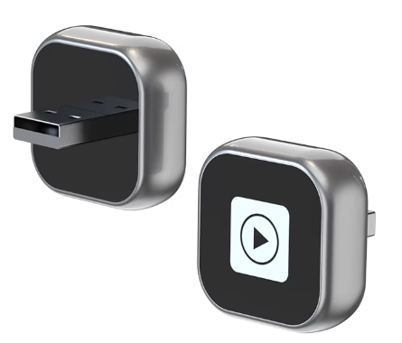

# YouCast YCA01 (C12P)



> [!CAUTION]
> Use at your own risk, no warranty. Read the [main page](../../README.md) first.

## Hardware

| | |
|---|---|
| Model | YouCast YCA01, project **C12P** |
| Platform | Allwinner V851S, ARM, Linux 4.9, musl (Liaoyuan OEM family) |
| Flash | XT25F128F, 16 MB SPI NOR |
| Stock firmware | `25102301.C12P` |
| Adapter address | Wi-Fi of the adapter, `http://192.168.1.101` |

The stock firmware has **no cluster display code at all**, neither towards the iPhone nor towards the car. It also let the cluster's settings overwrite the main screen's, so with a two-display head unit the main CarPlay screen came out squeezed (1010x376 stretched to 1264x640).

## What is changed

A library `libyc.so` is loaded into both CarPlay processes (`cps` towards the car, `wcp` towards the iPhone) and adds the whole cluster path:

- the cluster display is kept out of the main screen settings, so the main screen has correct proportions again;
- the cluster display (type 111) is added to the display list sent to the iPhone;
- the second video stream is received from the iPhone (ChaCha20-Poly1305), re-encrypted (AES-CTR) and sent to the car as a second screen;
- zoom, **View** and the other cluster commands from the car are forwarded to the iPhone;
- turn-by-turn (iAP2 route guidance `0x52xx`) is passed from the iPhone to the car, so the cluster shows native arrows, lanes and street names.

The adapter has no crypto library, so `libyc.so` carries its own ChaCha20-Poly1305 and AES-CTR, checked byte for byte against the adapter's own code.

### Safety: boot counter

The library runs from a copy in `/tmp`, so a web update can always unmount the app partition. A boot counter on the adapter's settings partition gives the library 5 starts: every boot uses one, and 10 seconds of both CarPlay processes running fills it back to 5. If the library ever breaks the start-up, the hook switches itself off after 5 boots and the adapter boots stock. Only a different build arms it again (uploading the same image does not).

Nothing else is written to the adapter's flash: logs stay in RAM and are gone after a power cycle. Installing this image over a test build also removes that build's saved logs.

## File

| File | SHA-256 |
|---|---|
| `c12p_050-4-32bc9459-rel.img` | `210f9017011d6ea9f3ec05787f12f1e6c9cbf7f0c19a9a9f7e4f469cd133fcda` |

The image is the stock C12P update package with the library and its start block added.

## Install (HTTP)

The adapter can be powered from any USB charger; the car is not needed.

1. Connect the computer to the adapter's Wi-Fi.
2. In this folder run:
   ```powershell
   curl.exe -F "file=@c12p_050-4-32bc9459-rel.img" "http://192.168.1.101/cgi-bin/index.cgi?id=upload"
   ```
3. Wait for the reboot. Do not unplug the adapter.
4. Open `http://192.168.1.101/ver.html`. It should show `rel libyc=050-4/ea6510da arm-ver=32bc9459`, `failsafe=1 udisk-logs=0`, and `libyc loaded` for `cps` and `wcp`.

## Logs

While the adapter is on, connect to its Wi-Fi and save:

- `http://192.168.1.101/yc.txt`: library log (`head unit SETUP 111 status=200`, `cmd to iPhone ... rc=0`)
- `http://192.168.1.101/ver.html`: image version, boot counter, which processes loaded the library
- `http://192.168.1.101/cgi-bin/index.cgi?id=logcat`: stock log (encrypted)
- `http://192.168.1.101/hu-info.bin`, `http://192.168.1.101/phyinfo.bin`: what the head unit reported

## Rollback

- **HTTP:** upload the stock C12P `update.img` from YouCast with the same `curl.exe` command. This image loads the library from `/tmp`, so the stock updater can unmount the app partition. Rollback over HTTP has not been tested yet.
- **Flash:** write back your own full chip dump with a programmer. This is how the adapter was restored to stock during development.

## Known issues

- Works only with the stock `25102301.C12P` package.
- Turn-by-turn on the cluster needs native guidance from [MHI2-Carplay-Maps](https://github.com/zakklmv/MHI2-Carplay-Maps) on the head unit.
- If the adapter has an older test build that loads the library from `/mnt/customer`, the web update hangs (LED blinking red). Write the stock firmware back with a programmer, then upload this image.
- Not for the square LY5101 box (`26102109.5101.x`): it is a different adapter.
